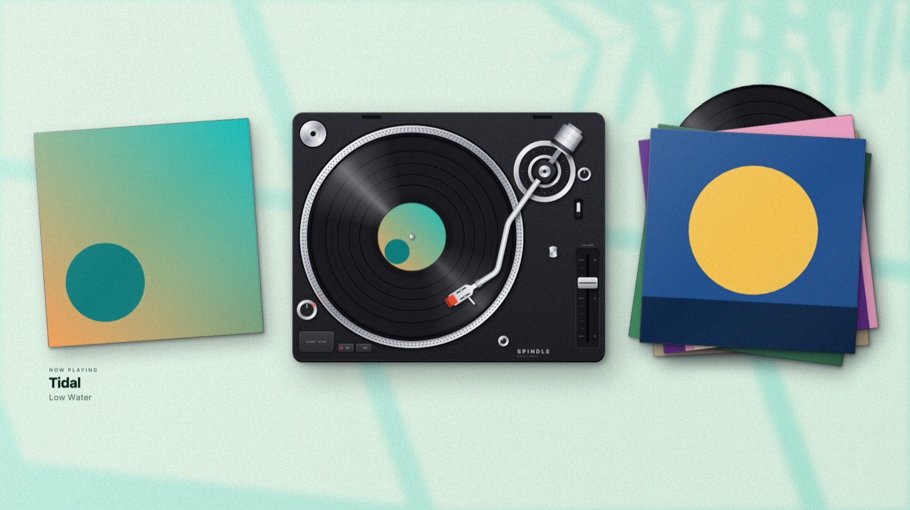

# Spindle

An illustrated turntable that lives on your Mac desktop as the wallpaper, seen from
straight above so the desktop becomes the desk. It shows what is playing in Spotify,
Apple Music or Spotifast: the record spins, the tonearm tracks the song, the cover lies
beside the deck, and earlier covers pile up on the other side. The desk takes its
colour from the cover. The turntable is also the remote: click and drag it to control
playback.



## Install

Spindle needs macOS 14 (Sonoma) or later, on an Apple silicon or Intel Mac.

1. Download the latest `Spindle-….dmg` from the
   [Releases page](https://github.com/dklingbeil/Spindle/releases/latest) and open it.
2. Drag **Spindle** onto the **Applications** folder in the window that appears.
3. Open **Applications** and double-click **Spindle**. macOS says it could not verify
   Spindle. That is expected: Spindle isn't registered with Apple, so macOS can't check
   it for you. Click **Done** (not Move to Trash).
4. Open **System Settings → Privacy & Security**, scroll down to **Security**, and click
   **Open Anyway** beside the line about Spindle. Click **Open Anyway** again when asked
   and confirm with your password or Touch ID.

That is only needed once. Spindle then opens and shows a short introduction. The same
steps are in a note on the disk image, for people who never see this page.

To remove it, choose **Quit Spindle** from its menu and drag it from Applications to
the Trash.

## Using it

Spindle has no Dock icon and no window. Everything is under the record icon in the
menu bar.

| Menu item | What it does |
| --- | --- |
| Play / Pause, Next Track, Previous Track | Controls the active player |
| Show / Hide Turntable | Hides the scene without quitting |
| Display | **Desktop Wallpaper** (behind your icons and windows) or a movable **Window** |
| Scene | **Daylight** (a sunlit desk), **Midnight** (lamplight), or **Turntable Only** (no desk; sits on your own wallpaper) |
| Size, Float Above Windows | Window mode only |
| Launch at Login | Starts Spindle when you log in |
| How to Use Spindle… | Shows the introduction again |

### Controlling playback from the turntable

| Do this | To |
| --- | --- |
| Click the record, the tonearm or the Start · Stop button | Play / pause |
| Drag the tonearm across the record | Seek: outer edge is the start of the track, the label is the end |
| Drag the tonearm off the record | Pause |
| Click the cover on the left | Next track |
| Click the pile of sleeves on the right | Previous track |
| Scroll over the turntable, or drag the fader up and down | Volume |

In wallpaper mode the scene sits behind your desktop icons, where macOS does not
deliver clicks. Spindle instead watches for clicks that land on empty desktop
(no window on top) and treats those as clicks on the scene. Finder still receives
them too, so dragging the tonearm also draws Finder's selection rectangle.

## If something isn't working

| What you see | Why, and what to do |
| --- | --- |
| The cover says "Play a track…" | Nothing is playing yet. Start a song in Spotify or Apple Music. |
| The record shows the song but clicking does nothing | macOS has not been told Spindle may control your music app. Spindle's menu shows **Allow Spindle to Control …**; choose it and switch Spindle on for that app. |
| All your windows slide away when you click the turntable | A macOS setting. In **System Settings → Desktop & Dock**, set **Click wallpaper to reveal desktop** to **Only in Stage Manager**. |
| The volume fader slides back and a note appears under the deck | The music is coming out of a phone or speaker that sets its own volume. Change the volume there. |
| macOS asks again whether Spindle may control your music app after an update | Spindle isn't registered with Apple, so macOS can treat a new version as a new app. Allow it again. |

## Supported players

| Player | How Spindle follows it | How Spindle controls it |
| --- | --- | --- |
| Spotify | System playback notifications, plus AppleScript for volume and position | AppleScript |
| Apple Music | System playback notifications, plus AppleScript for volume and position | AppleScript |
| Spotifast | Polls its command-line remote once a second | The same command-line remote |

- No login is needed for any of them.
- The first time Spindle talks to Spotify or Apple Music, macOS asks whether it may
  control that app. Without that, Spindle can still show what is playing but can't
  control it or read the volume.
- Spindle only talks to a player that is already running; it never launches one.

## Privacy

Spindle collects nothing and has no account. Covers come from the player when it
supplies one, otherwise from Spotify's public oEmbed endpoint or the iTunes Search API.
That lookup sends the track ID, or the artist and album name, to Spotify or Apple.

## Building it yourself

You need Xcode 15 or later and [XcodeGen](https://github.com/yonaskolb/XcodeGen), which
creates the Xcode project from `project.yml`:

```bash
brew install xcodegen
```

Generate the Xcode project (repeat this whenever you add files or edit `project.yml`):

```bash
xcodegen generate
```

Then either open `Spindle.xcodeproj` in Xcode and press Run, or build from the terminal:

```bash
xcodebuild -project Spindle.xcodeproj -scheme Spindle -configuration Debug -derivedDataPath build build
```

```bash
open build/Build/Products/Debug/Spindle.app
```

### Making the disk image

```bash
Scripts/make-dmg.sh
```

This builds a release for both Apple silicon and Intel and writes
`dist/Spindle-<version>.dmg`, containing the app, a shortcut to Applications and the
installation note from `Support/How to Install Spindle.html`. The version comes from
`project.yml`. Attach the file to a GitHub release to publish it.

The app is signed only for the Mac it was built on, not with an Apple Developer ID,
which is why other people have to approve it once in System Settings.

### Where things are

| File | What is in it |
| --- | --- |
| `project.yml` | App name, bundle identifier, version |
| `Sources/Plan.swift` | Where everything sits on the desk, in millimetres, and what counts as a click on each part |
| `Sources/Illustration.swift` | The artwork, drawn in code: deck, record, tonearm, sleeves, sunlight, default cover |
| `Sources/Palette.swift` | Picking the desk's colours from the cover |
| `Sources/Stage.swift` | The layers the artwork lives in and how they move: spin, arm, sleeves sliding to the pile |
| `Sources/SceneView.swift` | Pointer handling: what clicking and dragging each part does |
| `Sources/Player.swift` | Talking to Spotify, Apple Music and Spotifast |
| `Sources/Welcome.swift` | The introduction shown on first launch |
| `Sources/SpindleApp.swift` | Menu bar, the wallpaper window, desktop click forwarding |
| `Scripts/make-icon.swift` | Draws the app icon |
| `Scripts/make-dmg.sh` | Builds the disk image |

Everything is drawn in millimetres measured from the centre of the deck, so the
artwork stays sharp at any size. The deck's colours are at the top of
`Illustration.swift`; how light or vivid the desk gets is in `Palette.swift`.

To change the app icon, edit `Scripts/make-icon.swift` and run it from the repository root:

```bash
swift Scripts/make-icon.swift
```

## Limitations

- Wallpaper mode uses the main display only.
- The pile of earlier covers starts empty each time Spindle is opened.
- The app is not sandboxed or notarised.
